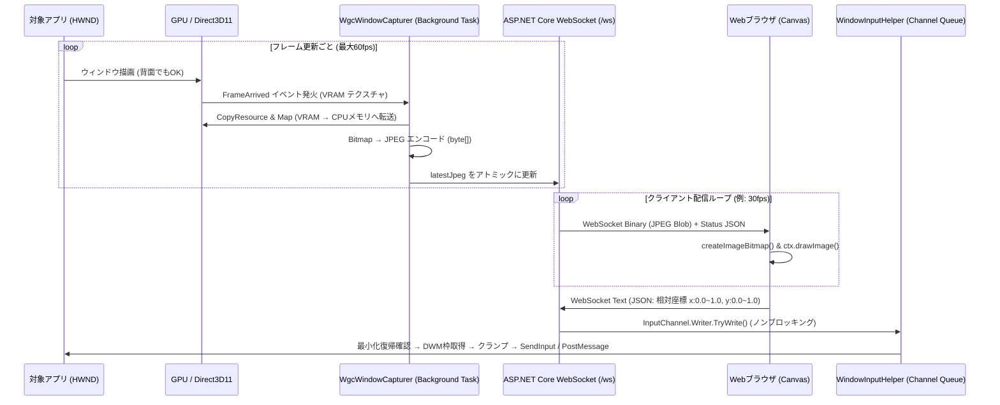

# C / Go / Python / TypeScript 経験者のための Single-App Remote Desktop コード＆仕組み解説

このドキュメントは、**C、Go、Python、TypeScript の知識はあるものの、C# (.NET 8) や Windows 固有の API (Win32 / COM / Direct3D11 / WinRT) には馴染みがない開発者**向けに、本プロジェクトの仕組みと C# 特有のイディオムを他言語と対比しながら解説したガイドです。

---

## 1. 全体像のメンタルモデル（他言語で例えると？）

このアプリケーションは、1つのプロセス内で以下の3つの役割を並行して動かしています。

| 役割 | 本プロジェクトの実装 (C#) | Go / Python / TS で例えると |
| :--- | :--- | :--- |
| **1. Web & WebSocket サーバー** | ASP.NET Core Minimal API (`./Program.cs`) | **Python**: `FastAPI` / **Go**: `net/http` + `gorilla/websocket` / **TS**: `Express` + `ws` |
| **2. GPU ウィンドウキャプチャ** | WGC API + Direct3D11 (`./Capture/WgcWindowCapturer.cs`, `./Capture/D3D11Helper.cs`) | **C**: Direct3D11 の COM ポインタ操作（vtable 経由の関数ポインタ呼び出し） |
| **3. OS 入力注入 & タスクトレイ** | Win32 P/Invoke + WinForms (`./Input/WindowInputHelper.cs`, `./Host/TrayApplicationContext.cs`) | **Python**: `ctypes.windll.user32` / **C**: `<windows.h>` の `SendInput`, `PostMessage` |

### データフロー図



---

## 2. 他言語経験者が最初に押さえるべき C# (.NET 8) の文法マップ

コードを読む際、以下の変換表を頭に入れておくとスムーズに読めます。

| C# の書き方 | 意味・挙動 | 他の言語での対応物 |
| :--- | :--- | :--- |
| `using var x = ...;` | スコープを抜ける時に自動で `x.Dispose()` を呼ぶ | **Go**: `defer x.Close()` / **Python**: `with ... as x:` / **TS**: `using x = ...` |
| `lock (obj) { ... }` | ミューテックスによる排他制御ブロック | **Go**: `mu.Lock(); defer mu.Unlock()` / **Python**: `with lock:` |
| `Channel<T>` | スレッドセーフな非同期メッセージキュー | **Go**: `chan T`（バッファ付きチャネル） / **Python**: `asyncio.Queue` |
| `Task.Run(() => ...)` | スレッドプール上で非同期ジョブを起動 | **Go**: `go func() { ... }()` |
| `async Task` / `await` | 非同期関数と待機（スレッドをブロックしない） | **TS / Python**: `async` / `await` とほぼ同じ（`Task<T>` ＝ `Promise<T>`） |
| `CancellationToken` | 非同期処理のキャンセル伝播トークン | **Go**: `context.Context` (`ctx.Done()`) / **TS**: `AbortSignal` |
| `IntPtr` (`nint`) | OS のネイティブポインタ / ハンドル型 | **C**: `void*` または `HWND` / **Go**: `uintptr` |
| `out var x` / `ref x` | 参照渡し（関数内で値を書き換えて返す） | **C**: `&x`（ポインタ渡し） / **Go**: 多値返却 `val, ok := fn()` に相当 |
| `record WindowEntry(...)` | イミュータブルな値比較データクラス | **Python**: `@dataclass(frozen=True)` / **TS**: `Readonly<{...}>` |
| `event Action? TargetChanged` | Pub/Sub イベント（コールバック関数のリスト） | **TS**: `EventEmitter` / **Python**: コールバック配列の登録・呼び出し |
| `""" ... """` | 生文字列リテラル（エスケープ不要の複数行文字列） | **Python**: `""" ... """` / **Go**: `` ` ... ` `` / **TS**: `` ` ... ` `` |

---

## 3. ファイル別・仕組みとコードの深掘り解説

### 3.1 `SingleAppRemote.csproj`（ビルド設定）

Python の `pyproject.toml`、Go の `go.mod`、TS の `package.json` + `tsconfig.json` に相当します。

```xml
<Project Sdk="Microsoft.NET.Sdk.Web">
  <PropertyGroup>
    <!-- コンソール画面を出さずにタスクトレイへ常駐する GUI アプリケーション指定 -->
    <OutputType>WinExe</OutputType>
    <!-- Windows 10 (ビルド 19041) 以降の WinRT API (WGC) を標準で使えるようにする指定 -->
    <TargetFramework>net8.0-windows10.0.19041.0</TargetFramework>
    <!-- TS の strictNullChecks: true に相当 -->
    <Nullable>enable</Nullable>
    <!-- C言語ライクな生ポインタ操作 (unsafe ブロック) を許可 -->
    <AllowUnsafeBlocks>true</AllowUnsafeBlocks>
    <!-- タスクトレイ常駐アイコン (NotifyIcon) や選択ダイアログを使うために WinForms を有効化 -->
    <UseWindowsForms>true</UseWindowsForms>
    <ApplicationIcon>app.ico</ApplicationIcon>
  </PropertyGroup>
</Project>
```

> [!TIP]
> **なぜ外部ライブラリ（NuGetパッケージ）が 0 個なのか？**
> `<TargetFramework>` に `windows10.0.19041.0` を指定し、`Microsoft.NET.Sdk.Web` を使うことで、「Webサーバー機能」「Windows Graphics Capture API」「WinForms タスクトレイ＆ダイアログ」がすべて .NET 8 標準 SDK だけで揃うため、サプライチェーンリスクや依存関係の破損がありません。

---

### 3.2 `Interop/NativeMethods.cs`（C言語 DLL の呼び出し層）

C# から Windows OS の C言語 API (`user32.dll`, `d3d11.dll`, `dwmapi.dll`) を呼び出すための定義ファイルです。Python の `ctypes` や Go の `syscall.NewLazyDLL` と同じ役割です。

#### ① `[DllImport("user32.dll")]`（P/Invoke）
```csharp
[DllImport("user32.dll")]
public static extern bool SetCursorPos(int X, int Y);
```
- Python で書く `ctypes.windll.user32.SetCursorPos(x, y)` と全く同じです。C# ランタイムが自動的に `user32.dll` をロードし、Cの関数シグネチャへ型変換（マーシャリング）して呼び出します。

#### ② `[StructLayout(LayoutKind.Sequential)]` と `[FieldOffset(0)]`
```csharp
[StructLayout(LayoutKind.Sequential)]
public struct RECT { public int Left, Top, Right, Bottom; }

[StructLayout(LayoutKind.Explicit)]
public struct InputUnion
{
    [FieldOffset(0)] public MOUSEINPUT mi;
    [FieldOffset(0)] public KEYBDINPUT ki;
}
```
- **C言語との対比**:
  - `LayoutKind.Sequential` は C の `struct` のメモリ配置をそのまま維持する指定です。
  - `LayoutKind.Explicit` + `[FieldOffset(0)]` は、C言語の **`union`（共用体）** そのものです。Win32 の `SendInput` API が受け取る `INPUT` 構造体は内部に `union { MOUSEINPUT mi; KEYBDINPUT ki; }` を持つため、オフセット `0` に重ねて定義しています。

#### ③ DWM 拡張フレームによる「見えない透明な影」の除去
```csharp
public static bool GetEffectiveWindowRect(IntPtr hwnd, out RECT rect)
{
    if (DwmGetWindowAttribute(hwnd, DWMWA_EXTENDED_FRAME_BOUNDS, out rect, Marshal.SizeOf<RECT>()) == 0)
        return true;
    return GetWindowRect(hwnd, out rect);
}
```
- **なぜこれが必要か？**: Windows 10/11 のウィンドウは、見た目の境界線の外側に「ドロップシャドウ（透明な影）領域」を左右・下に数ピクセル持っています。
- 古い `GetWindowRect` を使うと「影を含んだ大きめの矩形」が返ってきてしまい、一方で WGC キャプチャ映像は「影を除いた実際のウィンドウ映像」だけをキャプチャします。そのため、`DWMWA_EXTENDED_FRAME_BOUNDS` で**実際の描画矩形**を取得しないと、クリック位置が数ピクセルずれてしまいます。

---

### 3.3 `Capture/WgcWindowCapturer.cs` & `Capture/D3D11Helper.cs`（GPU キャプチャと C ポインタ操作）

ここが最も Windows 固有かつ低レイヤ（C / C++ 相当）な部分です。

#### なぜ Windows Graphics Capture (WGC) なのか？
昔ながらの `BitBlt` や `PrintWindow` には、「ハードウェアアクセラレーション（Chrome や VS Code、ゲーム等）が黒画面になる」「ウィンドウが重なると上のウィンドウが映り込む」という欠点がありました。
**WGC API** は OS のウィンドウ合成エンジン（DWM）から直接そのウィンドウ専用の GPU テクスチャを受け取るため、**対象ウィンドウが他のアプリの背後に隠れていても（最小化さえされていなければ）、対象アプリだけを綺麗に高速キャプチャできます**。

#### VRAM から CPU メモリへのコピー（`D3D11Helper.cs`）
WGC が返すフレームは **GPU の VRAM 上にある Direct3D11 テクスチャ**なので、CPU から直接バイト列として読めません。そこで以下の手順を踏んでいます：

1. **Staging Texture の作成 (`CreateStagingTexture`)**: CPU から読み取り可能な (`D3D11_CPU_ACCESS_READ`) 2D テクスチャバッファを用意する。
2. **GPU 間コピー (`CopyResource`)**: WGC のテクスチャ (`srcTex`) からステージングテクスチャ (`dstTex`) へコピーする。
3. **メモリマップ (`Map` / `Unmap`)**: CPU の仮想アドレス空間にマップし (`mapped.pData`)、`Bitmap` 経由で JPEG エンコードする。

#### C言語経験者向けの注目ポイント：COM vtable の直接呼び出し
`D3D11Helper.cs` では、外部ライブラリを使わずに Direct3D11 の COM インターフェースを呼ぶため、**C言語と全く同じポインタ演算と関数ポインタ呼び出し**を行っています：

```csharp
var vtable = *(IntPtr**)devicePtr;
var createTex2D = (delegate* unmanaged[Stdcall]<IntPtr, D3D11_TEXTURE2D_DESC*, IntPtr, IntPtr*, int>)vtable[5];
int hr = createTex2D(devicePtr, &desc, IntPtr.Zero, &texOut);
```
- **C言語で書くと**:
  `devicePtr->lpVtbl->CreateTexture2D(devicePtr, &desc, NULL, &texOut)` と完全に等価です。
- COM オブジェクトの先頭アドレスには仮想関数テーブル (`vtable`) へのポインタが入っており、`ID3D11Device` の5番目のメソッドが `CreateTexture2D`、`ID3D11DeviceContext` の14番目が `Map`、15番目が `Unmap`、47番目が `CopyResource` と ABI（バイナリ規約）で決まっているため、C# の `delegate* unmanaged[Stdcall]`（Cの関数ポインタ型）にキャストしてゼロオーバーヘッドで直接呼んでいます。

---

### 3.4 `Input/WindowInputHelper.cs`（非同期キュー入力注入と Kiosk 脱出防止）

ブラウザから送られてきた JSON イベントを受け取り、取りこぼしなく安全にウィンドウ内へ注入するモジュールです。

#### ① Go のチャネルに相当する `Channel<QueuedInput>` とデバウンス復帰
- WebSocket 受信スレッド（`recvTask`）がマウスのスリープ待機でブロックされないよう、受信したイベントは即座に `Channel.CreateUnbounded<QueuedInput>()` に積み、専用の単一バックグラウンドワーカー（`ProcessInputQueueAsync`）が順番に消化します。
- **`SendInputRestoreCursor` モードでの高速連打対策**:
  1クリックごとに毎回すぐ元の位置へカーソルを戻してしまうと、素早く連続クリックした際に物理マウスが引き戻されて座標ズレや入力抜けが起きます。
  そのため、**「最初のクリック直前のホストカーソル位置だけを記憶し、後続のキューが空になり最後の入力から 220ms 経過した時だけ元の位置へ戻す（デバウンス復帰）」** 仕組みを採用しています。

#### ② 脱出防止その1：最小化状態の復元待機と相対座標（`0.0〜1.0`）クランプ
- **最小化時のスタートメニュー誤爆防止**: Windows では最小化（`IsIconic`）されたウィンドウの座標は `(-32000, -32000)` という特殊値になります。そのため、座標変換を行う前に必ず `ShowWindow(SW_RESTORE)` で復元し、ウィンドウが画面内の有効な矩形（`Left > -10000` かつ `Width >= 32`）に戻るまで待ってから座標計算を行います。
- **相対座標クランプ**: ブラウザからは `0.0〜1.0` の比率のみを受け取り、`Math.Clamp(relX, 0.0, 1.0)` をかけた上で現在のターゲットウィンドウの1ピクセル内側 (`rect.Left` 〜 `rect.Right - 1`) に変換します。

#### ③ 脱出防止その2：システムショートカットの遮断
`IsBlockedSystemShortcut` で、以下のキー入力をサーバー側で破棄しています：
- `Meta` / `Win` キー単体および組み合わせ（スタートメニューや `Win+R`, `Win+D` 等の防止）
- `Alt + Tab` / `Alt + Esc`（別アプリへのフォーカス移動防止）
- `Alt + F4` / `Alt + Space`（アプリ終了やシステムメニュー表示の防止）
- `Ctrl + Esc` / `Ctrl + Shift + Esc` / `Ctrl + Alt + Del`（タスクマネージャー等の起動防止）

---

### 3.5 `Program.cs` & `Host/TrayApplicationContext.cs`（サーバーとタスクトレイの共存）

#### ASP.NET Core Minimal API（FastAPI / Express ライクな記述）
`Program.cs` のルーティング定義は、Python の FastAPI や TS の Express とほぼ同じ感覚で読めます：

```csharp
app.MapGet("/", async context => { ... });
app.Map("/ws", async context => { ... });
```
- **Kiosk 設計上のポイント**: 公開されているエンドポイントは `/`、`/favicon.ico`、`/ws` のみです。リモート側からターゲットウィンドウを変更するような API は存在しないため、ネットワーク越しに別アプリへ切り替えることは不可能です。

#### WinForms イベントループと Kestrel Web サーバーの同居
Windows のタスクトレイアイコン（`NotifyIcon`）やモーダルダイアログ（`WindowPickerDialog`）を動かすには、メインスレッド（STA: Single-Threaded Apartment）で Windows の GUI メッセージループ（`Application.Run`）を回す必要があります。
そのため、`Program.cs` では：
1. `var webTask = app.RunAsync();` で Web サーバーをバックグラウンド起動
2. メインスレッドで `Application.Run(trayContext);` を実行してタスクトレイメニューを待機
3. タスクトレイから「終了」が押されたら `app.Lifetime.StopApplication()` で全 WebSocket 接続と Web サーバーを即座にシャットダウン

という構成にしています。
